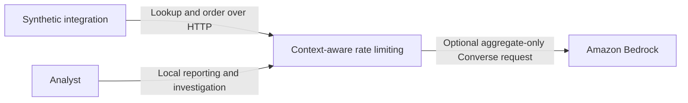
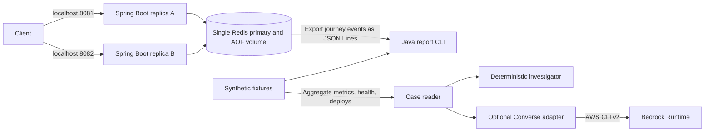

# Architecture

## C4 context

An integration uses a synthetic credential to look up a recipient and optionally confirm a fictitious payment order. An analyst runs the journey report and investigates a fall in conversion. In the optional remote mode Amazon Bedrock receives the same aggregate evidence as the local investigator.

## C4 containers and deployment

Each replica opens independent Jedis clients. The HTTP server, reporter and investigator have separate entry points. Running the CLI tasks starts plain Java processes. Report and investigation classes do not start a Spring context or construct Redis clients. The default investigation requires three scoped reads. The adapter sends their combined results in one prompt. The model has no callable tools. AWS credentials are supplied to the separately invoked AWS CLI by its normal credential provider.

## C4 components and state ownership

| Component | Responsibility | Boundary |
|---|---|---|
| Lookup | Validate the authenticated request, reserve before reading and submit the result | `POST /lookups`, synthetic directory |
| Order | Validate the caller and required reference, request an eligible confirmation | `POST /payment-orders` |
| Policy ledger | Own the authoritative bucket, enforce ownership and eligibility, deduplicate movements and business IDs | `policy.api.Ledger` |
| Monitoring | Correlate admitted lookups and downstream effects, aggregate by origin cohort, replay policies | `monitoring.api` and report CLI |
| Investigation | Limit case reads, compare observations, validate citations, select a next check | Case-scoped aggregate snapshot, local CLI and optional model adapter |

The two built-in credentials map to bounded integration labels. The request body cannot choose the bucket. The directory is a synthetic Redis-backed fixture. A Lua script records its logical read and result under the lookup ID, including the serving replica for the component test. A repeated call can retrieve the stored receipt. Inconclusive reads simulate a directory timeout.

## Atomicity and recovery

1. For each ledger change, WATCH the authenticated identity's hash. Copy its published bucket bytes to a private candidate key. Execute Bucket4j on that candidate using its Jedis CAS integration. A new identity starts with ten tokens.
2. Publish the candidate bytes, idempotency and business receipts, and the ordered journey event in one Redis MULTI/EXEC. A conflicting change invalidates the watch and restarts the calculation from the newly published state. A private candidate becomes authoritative only through successful publication.
3. A successful reservation records the generated lookup ID and binds the HTTP key to the recipient. If the response is lost, retrying the key recovers the correlation. The directory receipt and the ledger receipt handle redelivery at their respective boundaries.
4. A missing result commits the additional debit, outcome event and pending lookup ID together. The consumer acknowledges completion with a second transaction. Its failure injection point lies **after the first EXEC returns and before the acknowledgement**. While pending, new reservations for this identity return 503. A compatible redelivery or HTTP retry reads the applied receipt, clears the pending marker and preserves the bucket's elapsed refill. Recovery is initiated by redelivery.
5. Order confirmation checks the found result in the authenticated identity's hash. The order ID, first credit and event share a commit. Delivery keys can differ. The lookup ID remains the business key for one eligible order.

The evidence covers restarting a Spring consumer context with a surviving Redis primary and synchronized test clocks. Directory and ledger commits are separate. The idempotent synthetic directory supplies the receipt needed to bridge them. A production directory would need its own compatible contract. Loss of the Redis data, failover, clock skew and process termination during every possible instruction were outside the experiment. A crash before cleanup can leave an unpublished candidate. Receipts and the journal grow with the workload. The POC uses a single primary with exclusively owned keys, healthy storage and correct Redis types.

## Reporting and investigation

The event journal records opaque correlation IDs, bounded integration and release labels, type and epoch seconds. Order events also carry the opaque order ID. Recipient values used by the synthetic directory and credentials are excluded from reports. The report cuts off future observations, locates the origin admission and deduplicates by lookup ID and business effect. A late order is counted in the admission's window and version. A cohort matures at its end plus the configured completion grace period.

The policy replay measures Bucket4j calls in a single JVM on identical fixture timelines. The fixed rule reserves one token per read. The weighted rule also applies result costs and order credits. Read-only triage uses the weighted decisions and looks for two consecutive mature, sufficiently sampled windows without orders. Elapsed synthetic time to that signal and real method duration have separate fields. The incidence of a label in a fixture is an experimental assumption.

The investigator receives one immutable case snapshot. The read boundary validates source, dimensions, interval and remaining budget. Output statements use a bounded hypothesis vocabulary and numeric citations, with alternatives and next checks rendered from those hypotheses. The evaluator verifies cited values and checks whether the cited records support the comparative pattern. This measures evidence retrieval and hypothesis selection for the two prescribed cases. The simulated model returns a scripted Converse envelope. Its timing measures the local adapter path.

[Reproduction and measured results](evidence.md)
